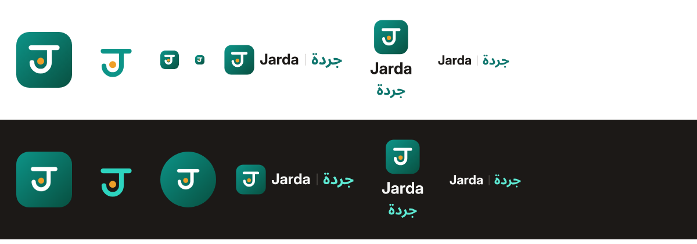

# Jarda · جردة logo

**The mark.** One stroke: a ledger line that turns down into a hook. Read in Latin it is the **J** of Jarda; read in Arabic it is the open bowl of the letter **ج** (jeem) of جردة, with its dot sitting inside. The amber dot is the item counted. The square tile carries the brand teal.

**The wordmark.** "Jarda" (Inter Bold) and "جردة" (Noto Sans Arabic Bold) side by side, divided by a thin bar, or stacked under the tile. Both fonts are SIL Open Font License. The letters are converted to outlines, shaped with HarfBuzz, so the Arabic joins and runs right-to-left the same everywhere, with no font installed.

| Colour      | Hex                   | Use                                      |
| ----------- | --------------------- | ---------------------------------------- |
| Teal        | `#0D9488` → `#085041` | Tile gradient, mark on light backgrounds |
| Amber       | `#EF9F27`             | The dot                                  |
| Ink         | `#1C1917` / `#F5F5F4` | "Jarda" on light / dark                  |
| Arabic teal | `#0F766E` / `#5EEAD4` | "جردة" on light / dark                   |

## Files

| Here                        | In the web app (`apps/web/public`)                                           | What                                     |
| --------------------------- | ---------------------------------------------------------------------------- | ---------------------------------------- |
| `logo.svg`, `logo-dark.svg` | `svg/logo-full(-dark).svg`, `png/logo-full(-dark).png`                       | Tile + Jarda / جردة on one line          |
| `logo-stacked(-dark).svg`   | `svg/logo-stacked(-dark).svg`                                                | Tile above both names                    |
| —                           | `svg/logo-wordmark(-dark).svg`                                               | Names only                               |
| `icon.svg`                  | `svg/logo-icon.svg`, `png/icon-*.png`, `pwa/icon-*.png`, `app/icon.png`      | The tile                                 |
| `mark.svg`, `mark-dark.svg` | `svg/logo-mark(-dark).svg`, `svg/safari-pinned-tab.svg`                      | Mark without the tile                    |
| —                           | `ico/favicon.ico`, `app/favicon.ico` (16/32/48)                              | Thicker strokes so it survives 16 px     |
| —                           | `png/apple-touch-icon.png`, `app/apple-icon.png` (180), `pwa/*-maskable.png` | Full-bleed square, mark in the safe zone |
| `og-image.png`              | `social/og-image.png`, `app/opengraph-image.png` (1200×630)                  | Share card, both languages               |

In code use `BrandLogo` (`apps/web/components/brand/brand-logo.tsx`); it swaps the light and dark artwork with the theme. Emails carry the tile as an inline image (`apps/api/src/common/brand-mail.ts`); PDFs draw it inline in their footer line (`brandFooterHtml`).

## Regenerating

`gen_logo.py` writes every SVG. It needs `fonttools` and `uharfbuzz` (`python3 -m venv v && v/bin/pip install fonttools uharfbuzz`) and the two fonts as static Bold instances in `fonts/` next to it (`Inter-Bold.ttf`, `NotoSansArabic-Bold.ttf`, instantiated from the Google Fonts variable files with `fontTools.varLib.instancer`, wght 700). PNGs were rendered from the SVGs with headless Chrome and resized with `sips`; the ICO packs the 16/32/48 PNGs.

Not checked: trademark registers (see [naming](../naming.md)).
